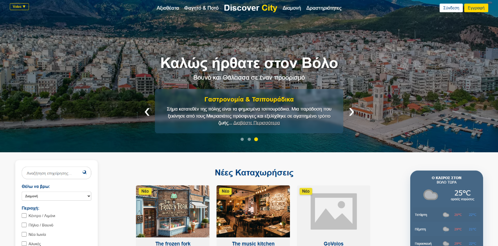

# Discover-City
A Laravel-based city guide and AI trip planner for Volos, built as a 2-person undergrad thesis. Features fuzzy search, interactive maps, and OpenAI integration.
<h1 align="center">Discover City 🏙️</h1>

  
  
  
  

A Laravel-based city guide and AI trip planner for Volos, built as a 2-person undergraduate thesis. 

<!-- Ξεσχολίασε την παρακάτω γραμμή και βάλε το σωστό path όταν ανεβάσεις ένα screenshot -->
<!-- 

 -->

**Key Features**
* **AI Trip Planner:** Generates personalized itineraries using OpenAI and real-time Open-Meteo weather data.
* **Smart Search:** Implements a Fuzzy Search algorithm (70% similarity threshold) for robust business discovery.
* **Interactive Maps:** Custom map integration using Leaflet.js for accommodations, food, and activities.
* **Dynamic User Flow:** AJAX-powered seamless interactions, user reviews, favorites via sessions, and automated role transitions.

**Tech Stack**
* **Back-End:** PHP 8, Laravel, MySQL
* **Front-End:** HTML/CSS, Vanilla JavaScript, AJAX (Fetch API)
* **APIs:** OpenAI, Open-Meteo

**Local Setup**
To run this project locally, execute the following commands:

git clone [https://github.com/UsernameSou/Discover-City.git](https://github.com/UsernameSou/Discover-City.git)
cd Discover-City
composer install
npm install
cp .env.example .env
php artisan key:generate
php artisan migrate
php artisan serve